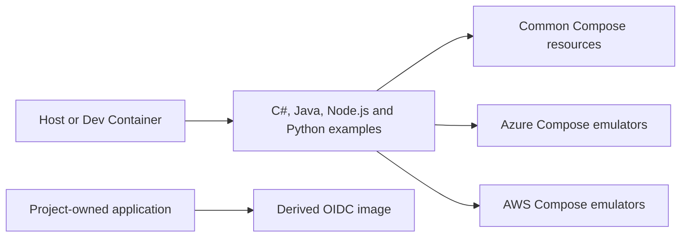

## Scope

Reviewed 2026-10-27. This is an uncommitted parity update based on source commit
`66f452566f589a05c520d2679b320d020284d5f5`. It is local developer infrastructure,
examples and reusable templates.

Each language runs independently outside the shared infrastructure. Resource
startup requires no application language SDK. The OIDC base is built separately
and instantiated by the consuming project.

## .NET projects

| Project | Framework | Direct project references |
| --- | --- | --- |
| `src/DeveloperToolbox.Example/DeveloperToolbox.Example.App/DeveloperToolbox.Example.App.csproj` | `net10.0` | DeveloperToolbox.Example.Lib, DeveloperToolbox.Example.Data, DeveloperToolbox.Example.Resources, DeveloperToolbox.Example.Messaging |
| `src/DeveloperToolbox.Example/DeveloperToolbox.Example.Data/DeveloperToolbox.Example.Data.csproj` | `net10.0` | None |
| `src/DeveloperToolbox.Example/DeveloperToolbox.Example.Functions/DeveloperToolbox.Example.Functions.csproj` | `net10.0` | DeveloperToolbox.Example.Data, DeveloperToolbox.Example.Resources, DeveloperToolbox.Example.Messaging |
| `src/DeveloperToolbox.Example/DeveloperToolbox.Example.Lambda/DeveloperToolbox.Example.Lambda.csproj` | `net10.0` | DeveloperToolbox.Example.Data |
| `src/DeveloperToolbox.Example/DeveloperToolbox.Example.Lib/DeveloperToolbox.Example.Lib.csproj` | `net10.0` | None |
| `src/DeveloperToolbox.Example/DeveloperToolbox.Example.Messaging/DeveloperToolbox.Example.Messaging.csproj` | `net10.0` | None |
| `src/DeveloperToolbox.Example/DeveloperToolbox.Example.Resources/DeveloperToolbox.Example.Resources.csproj` | `net10.0` | None |
| `tests/DeveloperToolbox.Example.App.Tests/DeveloperToolbox.Example.App.Tests.csproj` | `net10.0` | DeveloperToolbox.Example.App |
| `tests/DeveloperToolbox.Example.Data.Tests/DeveloperToolbox.Example.Data.Tests.csproj` | `net10.0` | DeveloperToolbox.Example.Data |
| `tests/DeveloperToolbox.Example.Functions.Tests/DeveloperToolbox.Example.Functions.Tests.csproj` | `net10.0` | DeveloperToolbox.Example.Functions |
| `tests/DeveloperToolbox.Example.Lambda.Tests/DeveloperToolbox.Example.Lambda.Tests.csproj` | `net10.0` | DeveloperToolbox.Example.Lambda |
| `tests/DeveloperToolbox.Example.Lib.Tests/DeveloperToolbox.Example.Lib.Tests.csproj` | `net10.0` | DeveloperToolbox.Example.Lib |
| `tests/DeveloperToolbox.Example.Messaging.Tests/DeveloperToolbox.Example.Messaging.Tests.csproj` | `net10.0` | DeveloperToolbox.Example.Messaging |
| `tests/DeveloperToolbox.Example.Resources.Tests/DeveloperToolbox.Example.Resources.Tests.csproj` | `net10.0` | DeveloperToolbox.Example.Resources |

## Other languages

| Root | Projects |
| --- | --- |
| `src/DeveloperToolbox.Java.Example` | Maven core, Functions and Lambda modules; Java 25 |
| `src/DeveloperToolbox.Example/DeveloperToolbox.Example.Node` | Independent Node 24 SDK, Functions and Lambda package |
| `src/DeveloperToolbox.Example/DeveloperToolbox.Example.Python` | Independent Python SDK, Functions and Lambda package |
| `src/DeveloperToolbox.Example/DeveloperToolbox.Example.Client` | Public Next.js 16.4 / React 19.3 example client |

## Resource inventory

See [the container guide](../containers/readme.md) for all 13 long-running
services, two one-shot jobs, host ports, volumes and initialization behavior.
[The OIDC guide](guides/local-oidc.md) defines the separate identity boundary.

## Verification evidence

[Current test inventory](parity/test-inventory.md) separates authored definitions
from expanded executions. [Verification](parity/verification.md) records actual
checks, image builds and limitations. Coverage is unavailable without a measured
coverage report; test counts do not establish assertion quality.
